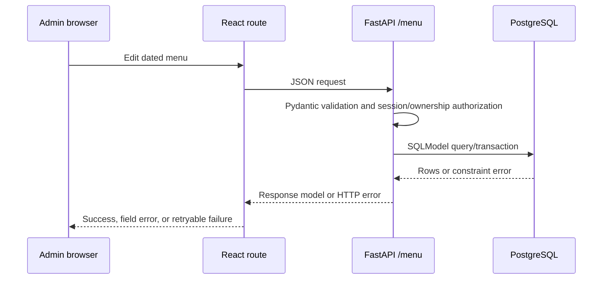

# Architecture

## Scope and implementation status

The selected system consists of two separate local directories:

- **Frontend:** `ai-freelance-mini/qr-menu` (React/TypeScript/Vite).
- **Backend:** `fastapi-projects` (FastAPI, SQLModel/SQLAlchemy async, PostgreSQL).

They are not one repository or a single verified deployment. The backend project currently identifies its FastAPI app as “Rangmanch Reviews API,” though its router includes QR-menu endpoints. Integration and deployment ownership are **TBD**. This document distinguishes observed behavior from planned changes.

## Existing architecture

```mermaid
flowchart LR
  Browser[Customer or vendor browser]
  React[React 19 + TypeScript + Vite]
  Router[React Router routes]
  Client[src/lib/menuApi.ts]
  API[FastAPI app in fastapi-projects]
  RouterAPI[/menu router]
  SQLModel[SQLModel models + async SQLAlchemy]
  PG[(PostgreSQL)]
  QR[qrcode library]

  Browser --> React
  React --> Router
  Router --> Client
  Client -->|HTTP JSON; default base http://localhost:8000| API
  API --> RouterAPI --> SQLModel --> PG
  React --> QR
```

### React frontend

- React 19 + TypeScript, Vite build, React Router v7.
- Entry: `src/main.tsx`; route composition in `src/App.tsx`; shared shell in `src/components/layout/AppShell.tsx`.
- Route-level screens are in `src/pages/`; HTTP helpers and response mapping are in `src/lib/menuApi.ts`.
- QR rendering is in `src/components/common/QrCode.tsx` using `qrcode`.
- Styling is Tailwind CSS 3 with global rules in `src/styles/index.css`, DM Sans and Playfair Display font imports.
- `VITE_API_BASE_URL` is read by the menu client, with fallback `http://localhost:8000`.
- `vercel.json` rewrites routes to `index.html`; this establishes SPA routing configuration, not proof of a deployed environment.

### FastAPI backend

- `main.py` creates the FastAPI app, initializes SQLModel tables in lifespan via `create_tables`, configures credentialed CORS for explicit frontend origins, and includes the menu and auth routers.
- `service/menu.py` has route and persistence logic; `schema/menu.py` defines Pydantic request/response models; `models/menu.py` has SQLModel tables; `database.py` configures async PostgreSQL connection/session.
- Backend uses `DATABASE_URL`, `asyncpg`, SQLAlchemy async, SQLModel, and `python-dotenv`.
- `create_tables()` calls `SQLModel.metadata.create_all`; no migration tool or migration history was verified.
- The observed menu route prefix is `/menu`, included without `/api`. The frontend client calls `/menu/...`, matching that prefix for menu functions. Backend title, API ownership, CORS allowlist, and production deployment need alignment.

### PostgreSQL integration and models

Implemented tables in `models/menu.py`:

- `users`, `vendors`, and `auth_sessions`: vendor/admin identities, restaurant ownership, and hashed server-side sessions.
- `menu_items`: integer ID, string `vendor_id`, name, optional description, string category, active flag, creation timestamp.
- `daily_menu_items`: integer ID, `vendor_id`, string date, FK to `menu_items.id`, float price, integer stock, availability, creation/update timestamps. Unique constraint on `(vendor_id, date, menu_item_id)`.

The daily table preserves price but does not snapshot the item name. `vendor_id` is not a foreign key to a restaurant table. Category is plain text. No publication or draft state is represented.

## Authentication and authorization

**Product context:** there is currently one global administrator; vendors may register accounts for their restaurants.

**Implemented:** vendor accounts register with an email, password, and restaurant name; admin registration is intentionally not public. The single admin is created with the backend's `create_admin.py` CLI. Passwords are PBKDF2-hashed; authenticated sessions use random opaque tokens stored as hashes in PostgreSQL and an HttpOnly cookie. Admin access spans vendors; vendor API access is restricted to that account's restaurant.

**Limitations:** vendor email verification, password reset, rate limiting, administrator recovery, and account lockout are not implemented. `AUTH_COOKIE_SECURE` defaults to `false` for local HTTP development and must be set to `true` behind HTTPS. `FRONTEND_ORIGINS` controls allowed browser origins; its local defaults are ports 5173 on localhost and 127.0.0.1. Production values and deployment configuration remain TBD.

## API communication and conventions

The frontend uses `fetch`, JSON, snake_case request/response types mapped to camelCase UI objects, and throws an `Error` containing response text on non-2xx. `src/lib/menuApi.ts` centralizes those calls. Current backend routes are FastAPI endpoint functions with Pydantic response models, authentication dependencies on vendor/admin data, and HTTP exceptions. See [`API_SPEC.md`](./API_SPEC.md) for exact observed and proposed contracts.

There is a second QR-menu-shaped FastAPI app under `ai-freelance/backend` that exposes `/api/menus/{restaurant_slug}` over in-memory sample data. It is not the selected backend for this specification. Do not merge its route or assume it uses PostgreSQL.

## Service/repository patterns

**Implemented:** `service/menu.py` combines routing, query construction, validation branches, and persistence. No distinct repository or domain-service layer was found. Database sessions are injected using `Depends(get_session)`.

**Proposed:** keep the existing FastAPI/SQLModel stack. For the planned publication, snapshot, and authorization behaviors, move nontrivial use cases into a small service layer if needed; retain the current endpoint style and session dependency. A dedicated repository abstraction is not required unless query reuse warrants it.

## Error handling and validation

- FastAPI validation errors and `HTTPException(detail=...)` are current conventions. Integrity errors are caught for registration and daily upsert/copy and mapped to 409.
- Schemas use Pydantic, but date/price/stock constraints are incomplete. Date is currently a string; price is float.
- Frontend catches request failures and displays error states on the vendor list and home instead of treating API failures as an empty vendor list.
- Proposed: typed date, decimal money, explicit validation errors, consistent public-safe messages, and no success-shaped fallback for failed requests. Preserve submitted admin data on retry.

## Logging and observability

Backend currently uses `print` during startup and SQLAlchemy engine `echo=True`; structured application logging, request IDs, metrics, and redaction policy were not verified. Proposed: standard structured logs, no credentials/payload secrets, operational health checks, and logging policy/retention **TBD**.

## Testing

- Frontend package scripts: `dev`, `build`, `preview`; no test or lint script/dependency was found.
- Backend now has isolated SQLite-backed auth/menu workflow tests under `tests/`; run them with `myenv\Scripts\python.exe -m unittest tests.test_vendor_auth_menu`.
- A separate `ai-freelance/backend` has pytest tests for a different in-memory API; these do not verify the selected PostgreSQL backend.
- Proposed test layers: React component/interaction tests, API contract tests, FastAPI async route tests, PostgreSQL integration/migration tests, auth tests, and public published-menu end-to-end tests. Tooling and CI are **TBD**.

## Error and request flow



## Proposed deployment architecture

Deploy the existing Vite-built SPA and FastAPI app as distinct services with PostgreSQL managed independently; exact providers, domains, networking, secrets manager, CI/CD, backup, TLS, migrations, and rollback are **TBD**. Configure `VITE_API_BASE_URL` for the deployed API and an explicit backend CORS origin list. Do not rely on wildcard CORS for credentialed admin traffic. Apply schema migrations as a controlled deployment step rather than runtime `create_all` once a migration strategy is adopted.

## Decisions required before implementation

1. Confirm backend repository ownership and app identity (QR menu vs current mixed project).
2. Choose restaurant timezone/currency and stable public slug/QR routing.
3. Define draft/revision/publish/unpublish semantics and snapshot timing.
4. Choose the single-admin credential/session mechanism and determine whether that admin manages one or multiple restaurants.
5. Choose migration tooling and deployment/CI ownership.
6. Define API path versioning/base prefix and standard error envelope.
