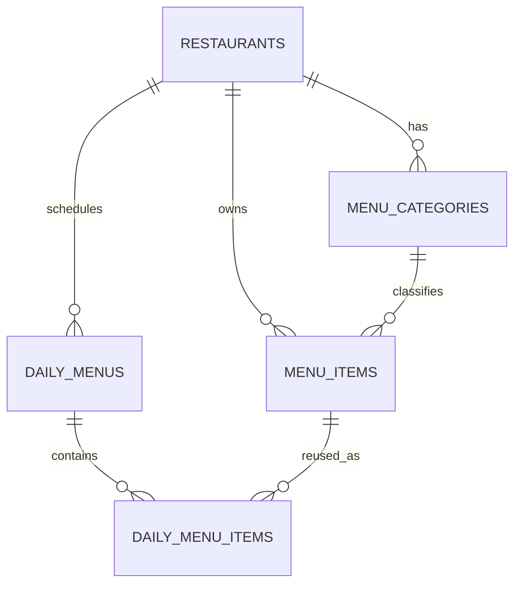

# Database Design

## Existing PostgreSQL design

The selected `fastapi-projects` backend uses PostgreSQL through `DATABASE_URL`, async SQLAlchemy/asyncpg, and SQLModel. `database.py` calls `SQLModel.metadata.create_all()` at application startup. No migration tool was found.

The account flow adds `users`, `vendors`, and `auth_sessions` tables using the existing SQLModel metadata. Startup `create_all()` creates these new tables; it is not a versioned migration system.

| Existing table | Observed columns and constraints |
|---|---|
| `users` | `id` integer PK; unique indexed `email`; `password_hash`; indexed `role` (`vendor` or `admin`); `created_at`. Admin account is provisioned out-of-band by `create_admin.py`; public registration always creates a vendor. |
| `vendors` | `id` integer PK; unique indexed `slug`; `name`; unique FK `owner_user_id` to `users.id`; `is_active`; `created_at`. |
| `auth_sessions` | SHA-256 hash of random session token as PK; FK `user_id`; indexed expiry; creation timestamp. Raw session tokens are only returned in HttpOnly cookies. |
| `menu_items` | `id` integer PK; `vendor_id` string indexed; `name` string indexed; nullable `description`; `category` string indexed; `is_active` bool default true; `created_at` datetime default UTC. |
| `daily_menu_items` | `id` integer PK; `vendor_id` string indexed; `date` string indexed; `menu_item_id` integer FK to `menu_items.id`; `price` float; `stock_count` int default 0; `available` bool default true; `created_at`, `updated_at` datetimes; unique `(vendor_id, date, menu_item_id)`. |

No Restaurant, MenuCategory, DailyMenu parent, draft/published status, ordering, item-name snapshot, or price snapshot column exists. The daily record's `price` acts as a date-specific price, but its name is read from the mutable catalogue.

## Proposed relational design

This is a target design proposal, not a description of deployed schema. Adapt identifiers and migrations after confirming backend ownership and PostgreSQL version. Use PostgreSQL `BIGINT`/identity or existing integer IDs consistently; the examples below use `BIGINT`.

### `restaurants`

| Column | Type | Constraints/notes |
|---|---|---|
| `id` | `BIGINT` | PK |
| `slug` | `VARCHAR(100)` | NOT NULL, UNIQUE; permanent public QR route key |
| `name` | `VARCHAR(200)` | NOT NULL |
| `timezone` | `VARCHAR(64)` | NOT NULL; supported value and default TBD |
| `currency_code` | `CHAR(3)` | NOT NULL; default TBD |
| `is_active` | `BOOLEAN` | NOT NULL, default true |
| `created_at`, `updated_at` | `TIMESTAMPTZ` | NOT NULL |

### `menu_categories`

| Column | Type | Constraints/notes |
|---|---|---|
| `id` | `BIGINT` | PK |
| `restaurant_id` | `BIGINT` | NOT NULL FK to `restaurants.id` |
| `name` | `VARCHAR(100)` | NOT NULL |
| `display_order` | `INTEGER` | NOT NULL, default 0 |
| `is_active` | `BOOLEAN` | NOT NULL, default true |

Unique `(restaurant_id, name)`. Whether categories are restaurant-scoped is a proposed MVP choice; confirm before migration.

### `menu_items` (catalogue)

| Column | Type | Constraints/notes |
|---|---|---|
| `id` | `BIGINT` | PK |
| `restaurant_id` | `BIGINT` | NOT NULL FK to `restaurants.id` |
| `category_id` | `BIGINT` | NOT NULL FK to `menu_categories.id` |
| `name` | `VARCHAR(200)` | NOT NULL |
| `description` | `TEXT` | NULL |
| `is_active` | `BOOLEAN` | NOT NULL, default true; soft deactivation |
| `created_at`, `updated_at` | `TIMESTAMPTZ` | NOT NULL |

Suggested index `(restaurant_id, is_active, category_id, name)`. Do not store the daily price as canonical catalogue price unless a separate default-price requirement is approved.

### `daily_menus`

One parent per restaurant/date in the MVP proposal. Revisions/multiple drafts per date would require a different uniqueness/version design (**TBD**).

| Column | Type | Constraints/notes |
|---|---|---|
| `id` | `BIGINT` | PK |
| `restaurant_id` | `BIGINT` | NOT NULL FK to `restaurants.id` |
| `menu_date` | `DATE` | NOT NULL, restaurant-local date |
| `status` | `VARCHAR(16)` | NOT NULL; check constraint `draft`/`published`/`unpublished` (or alternative lifecycle TBD) |
| `published_at` | `TIMESTAMPTZ` | NULL until published |
| `created_at`, `updated_at` | `TIMESTAMPTZ` | NOT NULL |
| `published_by` | `BIGINT` | nullable audit reference only if a persisted admin identity is introduced; otherwise omit for the single-admin MVP |

Unique `(restaurant_id, menu_date)` for a single record/date. Index `(restaurant_id, status, menu_date)`. If history of multiple publications must be retained, use immutable revisions and a pointer to current publication instead; decide before migration.

### `daily_menu_items`

| Column | Type | Constraints/notes |
|---|---|---|
| `id` | `BIGINT` | PK |
| `daily_menu_id` | `BIGINT` | NOT NULL FK to `daily_menus.id` |
| `menu_item_id` | `BIGINT` | NOT NULL FK to `menu_items.id` |
| `item_name_snapshot` | `VARCHAR(200)` | NOT NULL; name at chosen snapshot time |
| `description_snapshot` | `TEXT` | nullable; recommended for a historically consistent display |
| `category_name_snapshot` | `VARCHAR(100)` | NOT NULL; avoids historical reclassification changing display |
| `price_snapshot` | `NUMERIC(10,2)` | NOT NULL, check >= 0; currency-specific precision TBD |
| `display_order` | `INTEGER` | NOT NULL, default 0 |
| `stock_count` | `INTEGER` | NOT NULL, default 0, check >= 0; behavior/meaning TBD |
| `available` | `BOOLEAN` | NOT NULL, default true |
| `created_at`, `updated_at` | `TIMESTAMPTZ` | NOT NULL |

Unique `(daily_menu_id, menu_item_id)`. Index `(daily_menu_id, display_order)` and `(menu_item_id)`.

## Relationships

The foreign key from each daily row to a catalogue item establishes provenance; snapshot columns preserve historical rendering. Do not cascade catalogue deletion into daily historical records.

## Integrity and lifecycle rules

- A daily record must reference an item belonging to the same restaurant as its `daily_menus` parent. Enforce in application validation and, if required, composite-key/FK strategy.
- Daily membership is represented by presence of a `daily_menu_items` row. Removing membership deletes that join/selection only; it must not delete `menu_items`.
- Unavailable means selected but not currently offered; it differs from removal from the daily menu.
- Deactivate catalogue items rather than hard-delete. Historical daily rows remain readable regardless of current catalogue status.
- At snapshot time, copy catalogue display fields and the admin-entered daily price into snapshot fields. Editing catalogue data must not rewrite snapshots.
- Publish status change and public pointer/revision change must be atomic. Authorization is checked server-side.
- Validate price, stock, date, restaurant ownership, uniqueness, category ownership, and state transitions.
- Whether a published menu can be edited in place, requires a new revision, or must be unpublished before editing is **TBD**.
- Choose `ON DELETE RESTRICT` for catalogue references and a deliberate retention rule for restaurant/menu deletion. Do not add destructive cascades for historical records.

## Migration and data transition strategy

1. Confirm selected backend ownership, production database state, current schema, and backup/restore procedure. Do not infer this from local `.env`.
2. Adopt a migration tool and commit versioned schema/data migrations; stop relying on startup `create_all` for production evolution.
3. Add restaurants and categories; backfill unique restaurant rows from existing `vendor_id` values and category rows from observed category strings. Slug/name/timezone/currency mappings require product confirmation.
4. Add daily menu parent records from distinct `(vendor_id, date)` pairs. Convert date strings only after validating all values use `YYYY-MM-DD`.
5. Populate new `daily_menu_id`, snapshot name/description/category from the catalogue, and price from existing `daily_menu_items.price`; validate or quarantine orphaned/mismatched rows before adding constraints.
6. Add constraints and indexes after backfill validation. Deploy compatibility code if frontend/backend releases are not atomic.
7. Verify row counts, uniqueness, foreign keys, snapshot behavior, public query, rollback, and backups before removing old columns.
8. Remove or rename legacy columns only in a later migration after every client has moved.

No migration has been created or executed as part of this documentation task.
